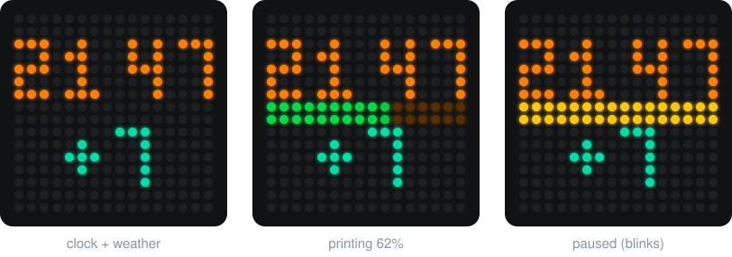
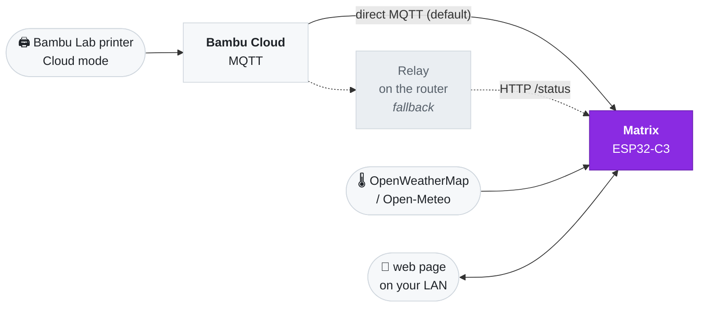

<div align="center">



### LED Matrix

A 16×16 desk clock on an ESP32-C3: the time, the outdoor temperature<br>
and a live Bambu Lab print-progress bar, straight from Bambu Cloud.

[](esp32_matrix_controller22/src/app.cpp)
[](esp32_matrix_controller22/README.md)
[](esp32_matrix_controller22/README.md)
[](LICENSE)

**English** · [Русский](docs/README.ru.md)

</div>

## Features

- **The time and the weather at a glance.** The clock in a 3×5 pixel font on top, the outdoor temperature below, coloured by how warm it is. Weather from OpenWeatherMap with an automatic fallback to Open-Meteo; the time zone follows the weather location.
- **Your print, live.** While a Bambu Lab printer works, a bar across the middle fills up with the progress. Preparing breathes, paused blinks yellow, a stopped print blinks red, a finished one breathes green. A short Wi-Fi or Cloud drop keeps the last bar on screen instead of blanking it.
- **No server in between.** The matrix signs in to Bambu Cloud itself (email + verification code), picks the printer, keeps its MQTT session and refreshes the token on its own. The printer stays in normal Cloud mode: Bambu Handy and Bambu Studio keep working.
- **Set up from a phone.** On first boot the matrix opens a Wi-Fi network `ESP32-Matrix-XXXXXX`; the web page at `192.168.4.1` scans networks and connects. All settings live in that page: brightness (manual, day/night or sunrise/sunset), colours, rotation and mirroring, weather, the printer.
- **Updates over the air that can't brick it.** Upload a new `.bin` in the web page. The image goes to the idle slot; three failed boots in a row roll back to the previous one by themselves.
- **Cool and quiet.** The frame is redrawn only when something visible changes, so the C3 idles near 50 °C instead of 70 °C.

> [!IMPORTANT]
> ### 🔒 The matrix trusts your home network
>
> The firmware follows [security level 0](docs/adr/0002-use-security-level-zero-for-local-access.md): the setup Wi-Fi is open and the web page and the `/api/*` endpoints have no password. Anyone on your LAN can change the settings, flash firmware or sign the printer out.
>
> - **Your Bambu password and verification code** are used for one sign-in and wiped from memory right after.
> - **The Cloud session** (access and refresh tokens) is kept in the matrix's flash (NVS), unencrypted, so it can refresh and reconnect after a power cut on its own.
> - The web page and the API never return tokens or the password, only states and reason codes.
>
> Keep the matrix on a network you trust. Don't expose port 80 to the internet.

## Quick start

You need an ESP32-C3 board, a 16×16 WS2812B matrix on GPIO 4 and a 5 V supply that can feed it.

```sh
brew install arduino-cli
arduino-cli config add board_manager.additional_urls \
  https://espressif.github.io/arduino-esp32/package_esp32_index.json
arduino-cli core update-index
arduino-cli core install esp32:esp32@3.3.8
arduino-cli lib install FastLED@3.10.3 ArduinoJson@7.4.3

cd esp32_matrix_controller22
arduino-cli compile --fqbn esp32:esp32:esp32c3:PartitionScheme=min_spiffs \
  --export-binaries -u -p /dev/cu.usbmodem101 .
```

Then:

1. Join the `ESP32-Matrix-XXXXXX` Wi-Fi and open `http://192.168.4.1`.
2. Pick your network. The matrix connects and shows its new address.
3. **Weather:** coordinates work with Open-Meteo and need no key; a city name needs an OpenWeatherMap key.
4. **Printer:** sign in with your Bambu account, enter the code from the email or SMS, choose the printer.

Later updates go through the web page: **Система → Обновление прошивки** (System → Firmware update) with `build/esp32.esp32.esp32c3/esp32_matrix_controller22.ino.bin`. The partition scheme must be `min_spiffs`: the image doesn't fit the default one. Full guide: [esp32_matrix_controller22/README.md](esp32_matrix_controller22/README.md).

## What the bar means

| Printer | On the matrix |
| --- | --- |
| idle | no bar, just the clock and the temperature |
| preparing | the first column breathes green on a dim track |
| printing | the track fills up green with the progress; the active column ramps smoothly |
| paused | the bar blinks yellow |
| error (the print stopped: failed, or paused with an HMS error) | the bar blinks red |
| finished | the full bar breathes green for a while, then goes back to idle |
| offline / no data for a moment | the last bar stays until the printer reports idle |

Informational HMS notices during a running print don't turn the bar red.

## How it works



**Direct Cloud** (the default since 4.4.0): the matrix holds the Bambu Cloud session and subscribes to the printer's MQTT report itself. The reports are parsed in a streaming way into one normalized printer state; malformed or partial reports never wipe the last good one.

**Relay** (optional fallback): a small Python service for OpenWrt in [`tools/bambu_relay/`](esp32_matrix_controller22/tools/bambu_relay/) that subscribes to the same MQTT and serves the state over HTTP. Switch to it in **Принтер → Источник статуса** (Printer → Status source) without a reboot.

The C3 has one core and ~50 KB of free heap after Wi-Fi, so only one TLS session runs at a time: Cloud HTTP, MQTT, the weather, sunrise times and OTA take turns. Design: [ADR-0001](docs/adr/0001-optimize-esp32-c3-and-move-bambu-cloud-on-device.md), [ADR-0002](docs/adr/0002-use-security-level-zero-for-local-access.md).

## Limitations

- **Bambu Lab Cloud mode only.** LAN-only mode is supported through the relay, not by the matrix directly.
- **The web page is in Russian**, and so are most of the docs.
- **One printer per matrix.**
- **No authentication on the LAN** (see above).
- **The Cloud session is stored unencrypted** in NVS: a reliability-over-security choice so the matrix recovers on its own after a reboot.
- **Two-factor TOTP sign-in** is covered by a contract test but has not been seen live; email and SMS codes are.
- **The finish of a print that ran entirely while the matrix was off** isn't announced if the job has the same name as the last one.

## Documentation

[Firmware: build, flash, OTA](esp32_matrix_controller22/README.md) ·
[Relay](esp32_matrix_controller22/tools/bambu_relay/README.md) ·
[Relay token rotation](esp32_matrix_controller22/tools/bambu_relay/TOKEN_ROTATION_RUNBOOK.md) ·
[ADRs](docs/adr/) ·
[Glossary (ru)](docs/CONTEXT.md) ·
[Development tickets (ru)](docs/development-tickets/)

Most of the docs are in Russian. [CLAUDE.md](CLAUDE.md) holds the working context for coding agents: the toolchain, decisions and known pitfalls.

## Development

```
esp32_matrix_controller22/
  esp32_matrix_controller22.ino   sketch entry point (opens in Arduino IDE)
  src/app.cpp                     firmware: display, Wi-Fi, weather, web server, OTA
  src/bambu_*.{hpp,cpp}           Bambu Cloud: auth, credentials, MQTT report parser, refresh
  src/*_policy.hpp                small pure policies (Wi-Fi backoff, MQTT gates, OTA display…)
  src/index_html.h                web UI source; index_html_gz.h — the served gzip
  tests/                          host C++ tests for the pure headers
  tools/                          web UI export, OTA/reboot loops, preview renderer
  tools/bambu_relay/              the OpenWrt relay and its tests
  web/index.html                  web UI with a mock API, opens from disk
docs/                             ADRs, development tickets, research, glossary
```

```sh
cd esp32_matrix_controller22

# host tests, no board needed
for t in tests/*_test.cpp; do
  c++ -std=c++17 -Isrc "$t" -o /tmp/t && /tmp/t || echo "FAIL $t"
done
python3 tools/bambu_relay/test_relay.py

# after editing src/index_html.h
sh tools/export_web_ui.sh && sh tools/generate_web_ui_gzip.sh
sh tools/check_web_ui_export.sh

# the picture at the top of this README
python3 tools/render_matrix_preview.py
```

The preview is rendered from the firmware's own font table and layout.

## License

[MIT](LICENSE).
Unofficial project, not affiliated with Bambu Lab.
