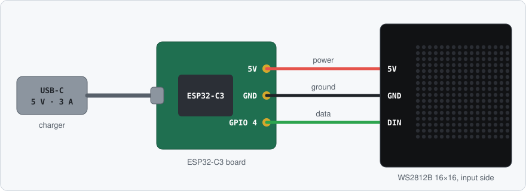
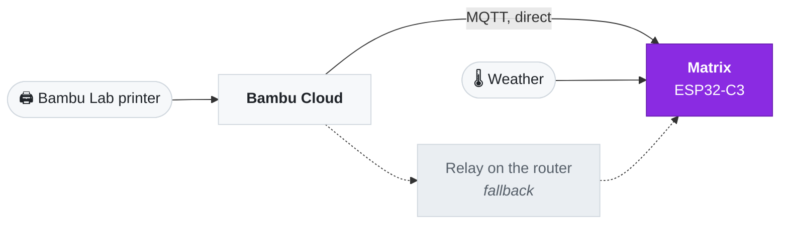

<div align="center">


### Bambu LED Matrix

A clock that knows how your 3D print is doing.

[](https://github.com/Keshaqaz/bambu-ledmatrix/releases/latest)
[](esp32_matrix_controller22/README.md)
[](esp32_matrix_controller22/README.md)
[](LICENSE)

**English** · [Русский](docs/README.ru.md)

</div>

A 16×16 LED matrix on an ESP32-C3 that shows the time, the weather and your
Bambu Lab print progress. **It talks to Bambu Cloud on its own**: no Home
Assistant, no Raspberry Pi, no laptop left open, no third-party server in
between. Plug it in and it works.

## Why it's nice

- **Needs nothing else.** Sign in to your Bambu account once from its page;
  after that it keeps the Cloud connection and renews access by itself. The
  printer stays in normal Cloud mode, so Handy and Studio work as before.
- **Readable across the room.** The clock on top, the outdoor temperature below
  (blue when cold, red when hot), the print bar in between.
- **Doesn't panic.** A Wi-Fi or Cloud hiccup leaves the bar where it was. After
  a power cut it reconnects on its own.
- **Updates over the air.** Upload new firmware on its own page. If the new
  version doesn't boot, it rolls back to the last one by itself.

## What the bar means

| Printer | Matrix |
| --- | --- |
| not printing | just the clock and the temperature |
| preparing | the first column breathes |
| printing | the bar fills up green |
| paused | blinks yellow |
| error, print stopped | blinks red |
| done | blinks green, then goes dark |

Informational printer notices during a print don't turn the bar red.

> [!IMPORTANT]
> **The matrix trusts your home network.** Its page and API have no password:
> anyone on your Wi-Fi can change the settings or the firmware. Your Bambu
> password is used once and wiped; the Cloud session is kept in flash,
> unencrypted, so the matrix can come back on its own after a power cut. Don't
> expose it to the internet. Details in
> [ADR-0002](docs/adr/0002-use-security-level-zero-for-local-access.md).

## Build one

**Hardware:** an ESP32-C3 board, a 16×16 WS2812B matrix and a USB-C charger,
5 V 3 A. Three wires, nothing to solder on the board but pins:



| ESP32-C3 | Matrix, input side |
| --- | --- |
| 5V | 5V |
| GND | GND |
| GPIO 4 | DIN |

- The matrix is powered through the board from the charger. The firmware caps
  the LEDs at 2.5 A, so 3 A is enough even at full white.
- Data goes straight to DIN, no level shifter or resistor in the author's build.
- Use the matrix's **input** end (DIN, not DOUT; usually an arrow on the PCB).
- Picture upside down or mirrored? Fix it in the settings (rotation, flip), no
  rewiring needed.

**Firmware.** The easy way: grab the file from the
[latest release](https://github.com/Keshaqaz/bambu-ledmatrix/releases/latest) and
flash it over USB (this wipes the board, saved settings included):

```sh
pip install esptool
esptool.py --chip esp32c3 write_flash 0x0 ledmatrix-4.4.11-usb.bin
```

<details>
<summary>Or build it yourself</summary>

```sh
brew install arduino-cli
arduino-cli config add board_manager.additional_urls \
  https://espressif.github.io/arduino-esp32/package_esp32_index.json
arduino-cli core update-index
arduino-cli core install esp32:esp32@3.3.8
arduino-cli lib install FastLED@3.10.3 ArduinoJson@7.4.3

cd esp32_matrix_controller22
arduino-cli compile --fqbn esp32:esp32:esp32c3:PartitionScheme=min_spiffs \
  --export-binaries -u -p /dev/cu.usbmodem101 .
```

The partition scheme must be `min_spiffs`: the firmware doesn't fit the default
one. More in the [firmware README](esp32_matrix_controller22/README.md).

</details>

**Setup:**

1. Join the `ESP32-Matrix-XXXXXX` Wi-Fi and open `192.168.4.1`.
2. Pick your home network.
3. Weather: coordinates (no key needed) or a city (needs an OpenWeatherMap key).
4. Printer: sign in to Bambu, enter the code from the email, pick the printer.

Later updates: **Система → Обновление прошивки** (System → Firmware update) with
`ledmatrix-4.4.11-ota.bin` from the release. The page is in Russian for now.

## How it works



The matrix subscribes to the printer's reports in Bambu Cloud and parses them
itself. The C3 has one core and little memory, so the Cloud, the weather and
updates take turns, and a frame is redrawn only when something on it changes.
That keeps the board at about 50 °C.

The [relay](esp32_matrix_controller22/tools/bambu_relay/) is an optional Python
service for an OpenWrt router. Use it if your printer is in LAN-only mode, or
keep it as a fallback; switch sources on the matrix page.

## Limitations

- Bambu Lab printers only, one per matrix.
- The settings page and most of the docs are in Russian.
- Sign-in with an authenticator-app (TOTP) code hasn't been tried live; email
  and SMS codes work.

## For developers

```
esp32_matrix_controller22/
  src/app.cpp         firmware: display, Wi-Fi, weather, web server, OTA
  src/bambu_*         Bambu Cloud: sign-in, session, report parsing
  src/index_html.h    the settings page
  tests/              host tests, no board needed
  tools/bambu_relay/  the router relay
docs/                 ADRs, tickets, research
```

```sh
cd esp32_matrix_controller22
for t in tests/*_test.cpp; do c++ -std=c++17 -Isrc "$t" -o /tmp/t && /tmp/t || echo "FAIL $t"; done
python3 tools/bambu_relay/test_relay.py
python3 tools/render_matrix_preview.py   # the picture on top
```

More: [firmware README](esp32_matrix_controller22/README.md) ·
[relay](esp32_matrix_controller22/tools/bambu_relay/README.md) ·
[ADRs](docs/adr/) · [glossary (ru)](docs/CONTEXT.md) ·
[CLAUDE.md](CLAUDE.md), context for coding agents.

## License

[MIT](LICENSE). Unofficial project, not affiliated with Bambu Lab.
