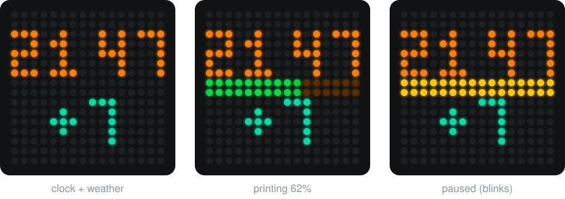
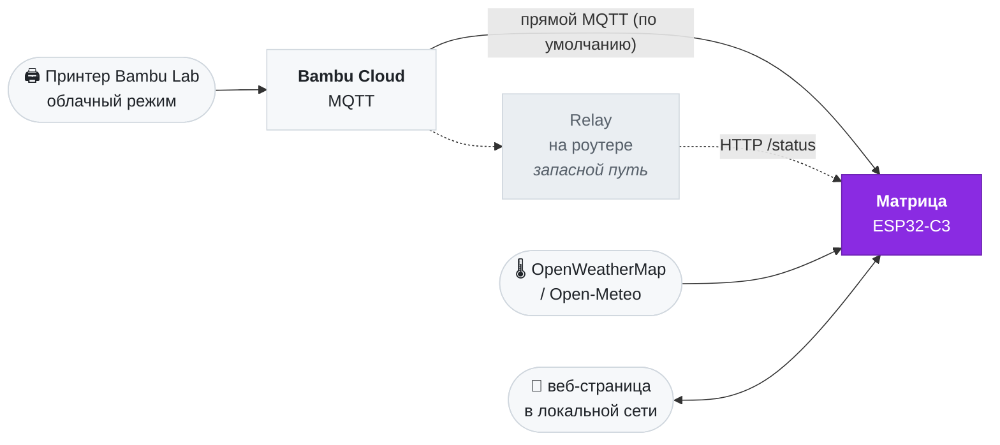

<div align="center">



### LED Matrix

Настольные часы 16×16 на ESP32-C3: время, температура на улице<br>
и живая полоса прогресса печати Bambu Lab — напрямую из Bambu Cloud.

[](../esp32_matrix_controller22/src/app.cpp)
[](../esp32_matrix_controller22/README.md)
[](../esp32_matrix_controller22/README.md)
[](../LICENSE)

[English](../README.md) · **Русский**

</div>

## Возможности

- **Время и погода одним взглядом.** Сверху часы пиксельным шрифтом 3×5, снизу температура на улице, цвет зависит от того, насколько тепло. Погода из OpenWeatherMap с автоматическим переходом на Open-Meteo; часовой пояс берётся из места погоды.
- **Печать в реальном времени.** Пока принтер Bambu Lab работает, полоса посередине заполняется по прогрессу. Подготовка «дышит», пауза мигает жёлтым, остановленная печать — красным, завершённая — зелёным. Короткий обрыв Wi-Fi или облака не гасит полосу — остаётся последняя.
- **Без сервера посередине.** Матрица сама входит в Bambu Cloud (email + код подтверждения), выбирает принтер, держит MQTT-сессию и сама обновляет токен. Принтер остаётся в обычном облачном режиме: Bambu Handy и Bambu Studio работают как раньше.
- **Настройка с телефона.** При первом запуске матрица поднимает Wi-Fi `ESP32-Matrix-XXXXXX`; страница на `192.168.4.1` находит сети и подключается. Все настройки — там же: яркость (вручную, день/ночь или по рассвету/закату), цвета, поворот и отражение, погода, принтер.
- **Обновления по воздуху без риска окирпичить.** Новый `.bin` загружается через веб-страницу в свободный слот; три неудачных загрузки подряд сами откатывают на предыдущую прошивку.
- **Холодная и тихая.** Кадр перерисовывается только когда меняется что-то видимое, поэтому C3 держится около 50 °C, а не 70 °C.

> [!IMPORTANT]
> ### 🔒 Матрица доверяет домашней сети
>
> Прошивка следует [security level 0](adr/0002-use-security-level-zero-for-local-access.md): Wi-Fi для настройки открыт, у веб-страницы и `/api/*` нет пароля. Любой в вашей локальной сети может менять настройки, прошивать матрицу или разлогинить принтер.
>
> - **Пароль Bambu и код подтверждения** используются для одного входа и сразу стираются из памяти.
> - **Облачная сессия** (access и refresh токены) хранится во flash матрицы (NVS) без шифрования — чтобы после отключения питания она сама обновилась и переподключилась.
> - Веб-страница и API никогда не отдают токены и пароль, только состояния и коды причин.
>
> Держите матрицу в сети, которой доверяете. Не открывайте порт 80 в интернет.

## Быстрый старт

Нужны плата ESP32-C3, матрица WS2812B 16×16 на GPIO 4 и блок питания 5 В, которого хватит на матрицу.

```sh
brew install arduino-cli
arduino-cli config add board_manager.additional_urls \
  https://espressif.github.io/arduino-esp32/package_esp32_index.json
arduino-cli core update-index
arduino-cli core install esp32:esp32@3.3.8
arduino-cli lib install FastLED@3.10.3 ArduinoJson@7.4.3

cd esp32_matrix_controller22
arduino-cli compile --fqbn esp32:esp32:esp32c3:PartitionScheme=min_spiffs \
  --export-binaries -u -p /dev/cu.usbmodem101 .
```

Дальше:

1. Подключитесь к Wi-Fi `ESP32-Matrix-XXXXXX` и откройте `http://192.168.4.1`.
2. Выберите свою сеть. Матрица подключится и покажет новый адрес.
3. **Погода:** координаты работают с Open-Meteo без ключа; для названия города нужен ключ OpenWeatherMap.
4. **Принтер:** войдите в аккаунт Bambu, введите код из письма или SMS, выберите принтер.

Следующие обновления — через веб-страницу: **Система → Обновление прошивки**, файл `build/esp32.esp32.esp32c3/esp32_matrix_controller22.ino.bin`. Схема разделов — только `min_spiffs`: в стандартную образ не помещается. Полное руководство: [esp32_matrix_controller22/README.md](../esp32_matrix_controller22/README.md).

## Что означает полоса

| Принтер | На матрице |
| --- | --- |
| простаивает | полосы нет, только часы и температура |
| подготовка | первый столбец «дышит» зелёным на тусклой дорожке |
| печать | дорожка заполняется зелёным по прогрессу; текущий столбец разгорается плавно |
| пауза | полоса мигает жёлтым |
| ошибка (печать остановлена: сбой или пауза с HMS-ошибкой) | полоса мигает красным |
| завершено | полная полоса мигает зелёным, потом возврат к простою |
| офлайн / данных на мгновение нет | последняя полоса остаётся до явного «простаивает» |

Информационные HMS-уведомления во время печати полосу красной не делают.

## Как это работает



**Прямой Cloud** (по умолчанию с 4.4.0): матрица держит облачную сессию Bambu и сама подписывается на MQTT-отчёты принтера. Отчёты разбираются потоково в одно нормализованное состояние принтера; битые или неполные отчёты никогда не затирают последнее хорошее.

**Relay** (необязательный запасной путь): небольшой Python-сервис для OpenWrt в [`tools/bambu_relay/`](../esp32_matrix_controller22/tools/bambu_relay/), который подписывается на тот же MQTT и отдаёт состояние по HTTP. Переключение — **Принтер → Источник статуса**, без перезагрузки.

У C3 одно ядро и ~50 КБ свободной кучи после Wi-Fi, поэтому одновременно идёт только одна TLS-сессия: облачный HTTP, MQTT, погода, рассвет/закат и OTA ходят по очереди. Архитектура: [ADR-0001](adr/0001-optimize-esp32-c3-and-move-bambu-cloud-on-device.md), [ADR-0002](adr/0002-use-security-level-zero-for-local-access.md).

## Ограничения

- **Только облачный режим Bambu Lab.** Режим LAN-only поддерживается через relay, не самой матрицей.
- **Один принтер на матрицу.**
- **Нет аутентификации в локальной сети** (см. выше).
- **Облачная сессия хранится без шифрования** в NVS: осознанный выбор надёжности в пользу самостоятельного восстановления после перезагрузки.
- **Вход с TOTP** покрыт контрактным тестом, но вживую не встречался; коды по email и SMS проверены.
- **Финиш печати, целиком прошедшей при выключенной матрице**, не анонсируется, если у задания то же имя, что у предыдущего.

## Документация

[Прошивка: сборка, прошивка, OTA](../esp32_matrix_controller22/README.md) ·
[Relay](../esp32_matrix_controller22/tools/bambu_relay/README.md) ·
[Ротация токена relay](../esp32_matrix_controller22/tools/bambu_relay/TOKEN_ROTATION_RUNBOOK.md) ·
[ADR](adr/) ·
[Глоссарий](CONTEXT.md) ·
[Тикеты разработки](development-tickets/)

[CLAUDE.md](../CLAUDE.md) — рабочий контекст для кодинг-агентов: тулчейн, принятые решения и известные грабли.

## Разработка

```
esp32_matrix_controller22/
  esp32_matrix_controller22.ino   точка входа скетча (открывается в Arduino IDE)
  src/app.cpp                     прошивка: экран, Wi-Fi, погода, веб-сервер, OTA
  src/bambu_*.{hpp,cpp}           Bambu Cloud: вход, хранение сессии, парсер MQTT, refresh
  src/*_policy.hpp                маленькие чистые политики (backoff Wi-Fi, MQTT-гейты, OTA-экран…)
  src/index_html.h                исходник веб-интерфейса; index_html_gz.h — отдаваемый gzip
  tests/                          host-тесты C++ для чистых заголовков
  tools/                          экспорт веб-интерфейса, OTA/reboot-циклы, рендер превью
  tools/bambu_relay/              relay для OpenWrt и его тесты
  web/index.html                  веб-интерфейс с мок-API, открывается с диска
docs/                             ADR, тикеты, исследования, глоссарий
```

```sh
cd esp32_matrix_controller22

# host-тесты, плата не нужна
for t in tests/*_test.cpp; do
  c++ -std=c++17 -Isrc "$t" -o /tmp/t && /tmp/t || echo "FAIL $t"
done
python3 tools/bambu_relay/test_relay.py

# после правки src/index_html.h
sh tools/export_web_ui.sh && sh tools/generate_web_ui_gzip.sh
sh tools/check_web_ui_export.sh

# анимированная картинка в начале README
python3 tools/render_matrix_preview.py
```

Превью рисуется из таблицы шрифта и раскладки самой прошивки.

## Лицензия

[MIT](../LICENSE).
Неофициальный проект, не связан с Bambu Lab.
