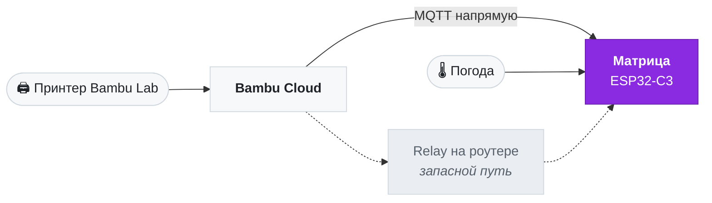

<div align="center">


### Bambu LED Matrix

Часы, которые знают, как дела у вашего 3D-принтера.

[](https://github.com/Keshaqaz/bambu-ledmatrix/releases/latest)
[](../esp32_matrix_controller22/README.md)
[](../esp32_matrix_controller22/README.md)
[](../LICENSE)

[English](../README.md) · **Русский**

</div>

Матрица 16×16 на ESP32-C3 показывает время, погоду и прогресс печати Bambu Lab.
**Она сама ходит в Bambu Cloud** — без Home Assistant, Raspberry Pi, открытого
ноутбука или чужого сервера посередине. Включили в розетку — работает.

## Что в ней хорошего

- **Ни от чего не зависит.** Вы один раз входите в аккаунт Bambu с её страницы,
  дальше она сама держит связь с облаком и сама продлевает доступ. Принтер
  остаётся в обычном облачном режиме: Handy и Studio работают как раньше.
- **Читается с другого конца комнаты.** Сверху часы, снизу температура за окном
  (цвет — от синего к красному), посередине полоса печати.
- **Не паникует.** Моргнул Wi-Fi или облако — полоса остаётся на месте.
  Отключили свет — после включения сама переподключится.
- **Обновляется по воздуху.** Новую прошивку загружаете на её же странице.
  Если та не заведётся, матрица сама откатится на прошлую.

## Что значит полоса

| Принтер | Матрица |
| --- | --- |
| не печатает | только часы и температура |
| готовится | «дышит» первый столбец |
| печатает | полоса заполняется зелёным |
| пауза | мигает жёлтым |
| ошибка, печать встала | мигает красным |
| готово | мигает зелёным, потом гаснет |

Информационные уведомления принтера во время печати полосу красной не делают.

> [!IMPORTANT]
> **Матрица доверяет домашней сети.** У её страницы и API нет пароля: любой в
> вашем Wi-Fi может поменять настройки или прошивку. Пароль Bambu используется
> один раз и стирается, а сессия облака хранится во flash без шифрования —
> чтобы матрица могла сама подняться после отключения питания. Наружу её не
> выставляйте. Подробнее — в [ADR-0002](adr/0002-use-security-level-zero-for-local-access.md).

## Как собрать

**Железо:** плата ESP32-C3, матрица WS2812B 16×16 и USB-C зарядка на 5 В 3 А.
Три провода:


| ESP32-C3 | Матрица, вход |
| --- | --- |
| 5V | 5V |
| GND | GND |
| GPIO 4 | DIN |

- Матрица питается через плату от зарядки. Прошивка ограничивает светодиоды
  током 2.5 А, так что 3 А хватает даже на полный белый.
- Данные идут прямо на DIN: в авторской сборке нет ни преобразователя уровней,
  ни резистора.
- Подключайтесь ко **входу** матрицы (DIN, а не DOUT; обычно на плате стрелка).
- Картинка вверх ногами или зеркально? Поправьте в настройках (поворот,
  отражение), перепаивать не нужно.

**Прошивка.** Проще всего взять готовый файл из
[релизов](https://github.com/Keshaqaz/bambu-ledmatrix/releases/latest) и залить по USB
(плата стирается целиком, вместе с настройками):

```sh
pip install esptool
esptool.py --chip esp32c3 write_flash 0x0 ledmatrix-4.4.11-usb.bin
```

<details>
<summary>Или собрать самому</summary>

```sh
brew install arduino-cli
arduino-cli config add board_manager.additional_urls \
  https://espressif.github.io/arduino-esp32/package_esp32_index.json
arduino-cli core update-index
arduino-cli core install esp32:esp32@3.3.8
arduino-cli lib install FastLED@3.10.3 ArduinoJson@7.4.3

cd esp32_matrix_controller22
arduino-cli compile --fqbn esp32:esp32:esp32c3:PartitionScheme=min_spiffs \
  --export-binaries -u -p /dev/cu.usbmodem101 .
```

Схема разделов — только `min_spiffs`, в стандартную прошивка не влезает.
Подробности — в [README прошивки](../esp32_matrix_controller22/README.md).

</details>

**Настройка:**

1. Подключитесь к Wi-Fi `ESP32-Matrix-XXXXXX` и откройте `192.168.4.1`.
2. Выберите домашнюю сеть.
3. Погода: координаты (ключ не нужен) или город (нужен ключ OpenWeatherMap).
4. Принтер: войдите в аккаунт Bambu, введите код из письма, выберите принтер.

Следующие обновления: **Система → Обновление прошивки**, файл
`ledmatrix-4.4.11-ota.bin` из релиза.

## Как это устроено



Матрица подписывается на отчёты принтера в Bambu Cloud и сама их разбирает.
У C3 одно ядро и мало памяти, поэтому облако, погода и обновления ходят по
очереди, а кадр перерисовывается только когда на нём что-то меняется — так
плата держится около 50 °C.

[Relay](../esp32_matrix_controller22/tools/bambu_relay/) — необязательный
Python-сервис для OpenWrt-роутера. Нужен, если принтер в режиме LAN-only или
как запасной вариант; переключается на странице матрицы.

## Ограничения

- Только принтеры Bambu Lab, один на матрицу.
- Страница настроек и большая часть документации — на русском.
- Вход с TOTP-кодом из приложения-аутентификатора вживую не проверен; коды по
  почте и SMS работают.

## Разработчикам

```
esp32_matrix_controller22/
  src/app.cpp         прошивка: экран, Wi-Fi, погода, веб-сервер, OTA
  src/bambu_*         Bambu Cloud: вход, сессия, разбор отчётов
  src/index_html.h    веб-страница настроек
  tests/              host-тесты, плата не нужна
  tools/bambu_relay/  relay для роутера
docs/                 ADR, тикеты, исследования
```

```sh
cd esp32_matrix_controller22
for t in tests/*_test.cpp; do c++ -std=c++17 -Isrc "$t" -o /tmp/t && /tmp/t || echo "FAIL $t"; done
python3 tools/bambu_relay/test_relay.py
python3 tools/render_matrix_preview.py   # картинка вверху
```

Ещё почитать: [README прошивки](../esp32_matrix_controller22/README.md) ·
[relay](../esp32_matrix_controller22/tools/bambu_relay/README.md) ·
[ADR](adr/) · [глоссарий](CONTEXT.md) ·
[CLAUDE.md](../CLAUDE.md) — контекст для кодинг-агентов.

## Лицензия

[MIT](../LICENSE). Неофициальный проект, с Bambu Lab не связан.
